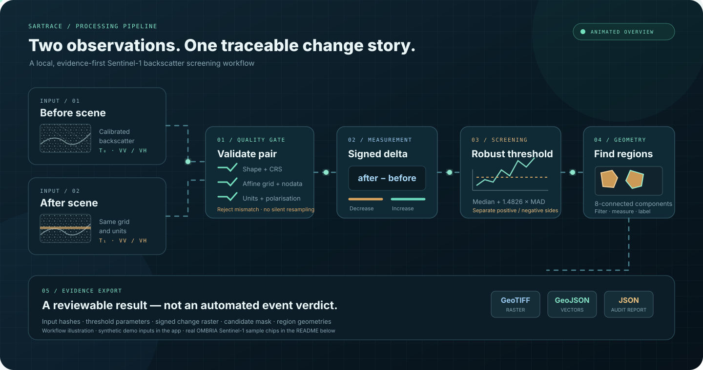

<div align="center">

# SARtrace

### From two radar observations to auditable change evidence.

**An evidence-first, local-first Sentinel-1 backscatter change-screening toolkit.**

[](CHANGELOG.md)
[](pyproject.toml)
[](tests/)
[](LICENSE)
[](docs/OMBRIA_BENCHMARK.md)

**Compare. Measure. Trace. Export.**

[Quick start](#-quick-start) · [Workflow](#-how-it-works) · [Real SAR samples](#-real-sentinel-1-data) · [Benchmark](#-ombria-benchmark) · [Limitations](#-scope-and-limitations)

</div>

---

## The idea

A Sentinel-1 radar image captures how the Earth's surface reflects radar energy at one point in time. A second acquisition captures it later. SARtrace compares the two **after they have been calibrated, terrain-corrected and co-registered to the same grid**.

It measures signed backscatter change, highlights candidate regions, and exports the analysis as geospatial evidence.

> **Where did the radar signal change, by how much, and what evidence can an analyst inspect?**

A change is not automatically a flood, a building, or damage. Moisture, vegetation, surface roughness, geometry, speckle and registration error can also alter radar backscatter.

## How it works

<div align="center">

<sub>Animated workflow illustration. The built-in app demo uses deterministic synthetic inputs; genuine OMBRIA Sentinel-1 samples are shown below.</sub>
</div>

### Processing stages

1. **Validate the pair.** Check dimensions, CRS, affine transform, nodata, polarisation and declared units. Misaligned scenes are rejected; they are never silently resampled.
2. **Compare the signal.** Convert known linear-power inputs to dB when requested, then calculate `delta = after − before`.
3. **Screen robustly.** Estimate a median/MAD-based threshold and keep decreases and increases separate.
4. **Extract candidate regions.** Use 8-connected components, filter small regions and calculate signal statistics.
5. **Export evidence.** Package signed GeoTIFF layers, GeoJSON regions, a JSON report and input provenance.

### What gets exported?

| File | What it contains |
|---|---|
| `delta_backscatter_db.tif` | Signed after-minus-before backscatter difference |
| `change_candidates.tif` | Candidate classes: stable, decreased, increased, invalid |
| `relative_evidence_index.tif` | Relative signal-strength diagnostic — **not a probability** |
| `change_regions.geojson` | Candidate region geometries for GIS inspection |
| `analysis_report.json` | Thresholds, input hashes, grid details and region statistics |

## Real Sentinel-1 data

The following three matched sample chips are from the public [OMBRIA dataset](https://github.com/geodrak/OMBRIA), sample `0001` in the official training split. They are genuine Sentinel-1 VV image chips and their associated Copernicus Emergency Management Service (EMS) reference mask.

<table>
<tr><th align="center">BEFORE · Sentinel-1 VV</th><th align="center">AFTER · Sentinel-1 VV</th><th align="center">EMS reference mask</th></tr>
<tr>
<td align="center"><a href="https://github.com/geodrak/OMBRIA/blob/master/OmbriaS1/train/BEFORE/S1_before_0001.png"></a></td>
<td align="center"><a href="https://github.com/geodrak/OMBRIA/blob/master/OmbriaS1/train/AFTER/S1_after_0001.png"></a></td>
<td align="center"><a href="https://github.com/geodrak/OMBRIA/blob/master/OmbriaS1/train/MASK/S1_mask_0001.png"></a></td>
</tr>
</table>

<sub>Source: <a href="https://github.com/geodrak/OMBRIA">geodrak/OMBRIA</a>, <code>OmbriaS1/train</code>, sample 0001. OMBRIA dataset DOI: <a href="https://doi.org/10.5281/zenodo.6777870">10.5281/zenodo.6777870</a>, licence <a href="https://creativecommons.org/licenses/by/4.0/">CC BY 4.0</a>. Images are linked to their original source and are not copied into this repository.</sub>

**Unit note:** OMBRIA preview chips are single-band 256 × 256, 8-bit VV intensity PNGs. Their values are digital numbers (DN), **not calibrated dB or sigma-nought**. SARtrace keeps this dataset-specific benchmark separate from the calibrated GeoTIFF analysis workflow.

## ✦ Capabilities

| Capability | Implementation |
|---|---|
| Strict raster contract | Single-band inputs; dimensions, CRS, transform and nodata validation |
| Unit-aware analysis | Calibrated dB or explicitly declared linear-power backscatter |
| Robust screening | Median/MAD threshold with configurable floor and multiplier |
| Signed candidates | Decreased and increased backscatter remain separate |
| Region analysis | 8-connected components, size filtering and region statistics |
| Geospatial export | GeoTIFF, GeoJSON and JSON audit report |
| Local-first app | Streamlit interface with deterministic synthetic demo |
| Benchmark harness | Four model-free baselines, train/test and event-held-out protocols |

## 🚀 Quick start

**Requirements:** Python 3.10–3.12.

```bash
git clone https://github.com/Prakash-codeMaker/SARtrace.git
cd SARtrace
python -m venv .venv

# Windows PowerShell
.venv\Scripts\Activate.ps1

# macOS / Linux
# source .venv/bin/activate

python -m pip install --upgrade pip
pip install -r requirements.txt
streamlit run app.py
```

Open the local Streamlit URL and select **Synthetic radar pair** to explore the complete workflow. The demo is deterministic and clearly labelled synthetic.

### Run tests

```bash
pip install -e ".[dev]"
python -m pytest -q
```

**Release verification:** 26 automated tests passed for v0.3.0. They cover deterministic fixtures and data-integrity behavior; they do not establish scientific accuracy on independent real scenes.

## 🧪 OMBRIA benchmark

SARtrace includes four model-free baselines:

1. Otsu threshold on after-event intensity.
2. Fixed global threshold on after-event intensity.
3. Fixed threshold on temporal intensity difference.
4. Robust median/MAD threshold on temporal intensity difference.

The harness supports official training-to-test evaluation, official-training-calibrated event holdouts, and leave-one-event-out cross-validation across available 2021 event groups. Albania (EMS 501), Timor (507) and Guyana (514) are treated as the primary new-event groups; France (492) is reported separately as a recurrence/geographic stress test.

Run the full benchmark from a network-enabled machine:

```bash
python scripts/run_ombria_benchmark.py --download --require-all-events \
  --data-root data/ombria \
  --output-dir artifacts/ombria-v0.3
```

The downloader checks the MD5 published on the Zenodo record before safe extraction. The runner writes per-chip, per-event, aggregate, calibration and SHA-256 input-manifest outputs. See [the complete benchmark protocol](docs/OMBRIA_BENCHMARK.md).

<blockquote>
<strong>Important:</strong> the benchmark implementation and fixture tests are included, but the full OMBRIA archive was not downloaded and processed during the v0.3.0 build. No real-data precision, recall, F1 or IoU scores are claimed in this repository. Do not treat the existence of an evaluation protocol as a benchmark result.
</blockquote>

### Keep the units separate

- **GeoTIFF core:** calibrated dB or known linear-power backscatter.
- **OMBRIA harness:** 8-bit PNG intensity values in DN.

A threshold learned from OMBRIA DN values must not be described as a calibrated dB threshold or transferred directly to ICEYE data.

## 🛰️ Use your own Sentinel-1 scenes

The GeoTIFF workflow expects two already-preprocessed scenes. Prepare them using a SAR processing chain such as [ESA SNAP](https://step.esa.int/main/toolboxes/snap/) or [pyroSAR](https://github.com/johntruckenbrodt/pyroSAR).

Before upload, each scene should be:

- radiometrically calibrated;
- terrain-corrected / geocoded;
- co-registered to the exact same pixel grid;
- acquired with comparable geometry (ideally matching relative orbit, pass direction and polarisation); and
- expressed in the same known units.

Useful discovery resources: [Copernicus Data Space Browser](https://dataspace.copernicus.eu/browser/), [Copernicus STAC API](https://documentation.dataspace.copernicus.eu/APIs/STAC.html) and [ASF Vertex](https://vertex.daac.asf.alaska.edu/).

## Scope and limitations

| SARtrace does | SARtrace does not yet do |
|---|---|
| Compare a compatible pair of preprocessed backscatter rasters | Download or preprocess raw Sentinel-1 SAFE products |
| Screen signed changes and find candidate regions | Apply orbit files, thermal-noise removal, calibration or terrain correction |
| Export GIS-ready evidence and provenance | Automatically co-register or resample input scenes |
| Compare transparent baseline methods | Confirm that a change is a flood or another specific event |
| Run local synthetic examples | Produce calibrated probabilities or operational alerts |

SARtrace is a **change-screening and evidence-export prototype**, not a flood-mapping authority or an operational early-warning service. Human and domain-expert review remains essential.

## Project structure

```text
SARtrace/
├── app.py
├── sartrace/
│   ├── core.py
│   ├── thresholds.py
│   ├── io.py
│   ├── demo.py
│   └── benchmark_ombria.py
├── scripts/
│   └── run_ombria_benchmark.py
├── tests/
├── docs/
│   ├── assets/sartrace-workflow.svg
│   ├── ARCHITECTURE.md
│   ├── OMBRIA_BENCHMARK.md
│   ├── RESEARCH_NOTES.md
│   ├── VALIDATION.md
│   └── V0_3_RELEASE_REPORT.md
├── .github/workflows/tests.yml
├── pyproject.toml
└── requirements.txt
```

## Documentation

- [Architecture](docs/ARCHITECTURE.md)
- [OMBRIA benchmark protocol](docs/OMBRIA_BENCHMARK.md)
- [Research notes and related projects](docs/RESEARCH_NOTES.md)
- [Validation notes](docs/VALIDATION.md)
- [v0.3.0 release report](docs/V0_3_RELEASE_REPORT.md)
- [Changelog](CHANGELOG.md)
- [Citation metadata](CITATION.cff)

## Research basis and acknowledgements

- OMBRIA: Drakonakis et al., *A Semantically Annotated Large-Scale Dataset of SAR Images for Flood Detection*, IEEE JSTARS (2022), [DOI: 10.1109/JSTARS.2022.3155559](https://doi.org/10.1109/JSTARS.2022.3155559). Dataset record: [10.5281/zenodo.6777870](https://doi.org/10.5281/zenodo.6777870).
- [GDAL](https://github.com/OSGeo/gdal) provides foundational geospatial raster/vector interoperability.
- [pyroSAR](https://github.com/johntruckenbrodt/pyroSAR) and [ESA SNAP](https://step.esa.int/main/toolboxes/snap/) are relevant SAR preprocessing resources.

The project draws on public research and engineering patterns; it does not copy source code from the referenced repositories.

## License

SARtrace source code is released under the MIT License. Dataset content remains subject to its original dataset licence and is not redistributed in this repository.

---

<div align="center">

**SARtrace · v0.3.0**  
*Make change visible. Keep the evidence traceable.*

</div>
