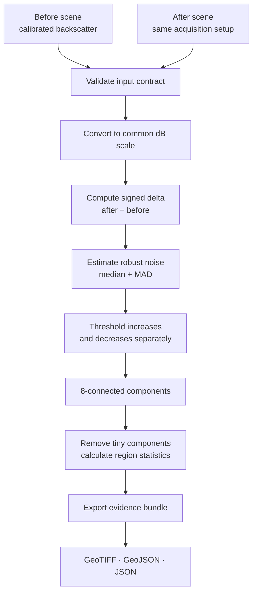

<div align="center">

# SARtrace

### From two radar observations to auditable change evidence.

**An evidence-first, local-first Sentinel-1 backscatter change-screening toolkit.**

[](CHANGELOG.md)
[](pyproject.toml)
[](tests/)
[](LICENSE)
[](docs/OMBRIA_BENCHMARK.md)

**Compare. Measure. Trace. Export.**

[Quick start](#-quick-start) · [How it works](#-how-it-works) · [Real SAR sample](#-real-sentinel-1-data-in-the-readme) · [Benchmark](#-benchmarking-with-ombria) · [Limitations](#-what-sartrace-does-and-does-not-do)

</div>

---

## The idea in 15 seconds

A Sentinel-1 radar image is captured over an area. Another image is captured later over the same area. SARtrace compares the two **only after they have been calibrated, terrain-corrected and co-registered to the same grid**. It measures the signed backscatter difference, highlights unusual candidate regions, and packages the evidence for inspection.

> **Where did the radar signal change, by how much, and what evidence can I export for someone to review?**

It does **not** decide what caused the change. Flooding, soil moisture, vegetation, construction, geometry and other effects can all influence radar backscatter.

## See the workflow

<div align="center">


<sub>This animation uses SARtrace's deterministic synthetic demo inputs — <strong>it is not a real Sentinel-1 acquisition</strong>. Real OMBRIA Sentinel-1 chips are shown below.</sub>

</div>

### What the analysis produces

<div align="center">


<sub>Static product preview from the deterministic synthetic demonstration. The sample shapes are simulated to show both decreased and increased backscatter.</sub>

</div>

## Real Sentinel-1 data in the README

These are **real Sentinel-1 sample chips** from the public [OMBRIA dataset](https://github.com/geodrak/OMBRIA), not generated illustrations. The three files are the matched `0001` sample from OMBRIA's training split: before event, after event, and the associated Copernicus Emergency Management Service (EMS) reference mask.

<table>
<tr><th align="center">BEFORE · Sentinel-1</th><th align="center">AFTER · Sentinel-1</th><th align="center">EMS reference mask</th></tr>
<tr>
<td align="center"><a href="https://github.com/geodrak/OMBRIA/blob/master/OmbriaS1/train/BEFORE/S1_before_0001.png"></a></td>
<td align="center"><a href="https://github.com/geodrak/OMBRIA/blob/master/OmbriaS1/train/AFTER/S1_after_0001.png"></a></td>
<td align="center"><a href="https://github.com/geodrak/OMBRIA/blob/master/OmbriaS1/train/MASK/S1_mask_0001.png"></a></td>
</tr>
</table>

<sub>Source: <a href="https://github.com/geodrak/OMBRIA">geodrak/OMBRIA</a>, <code>OmbriaS1/train</code>, sample 0001. The dataset is not bundled here. OMBRIA is distributed under <a href="https://creativecommons.org/licenses/by/4.0/">CC BY 4.0</a>; cite the dataset and its paper when reusing it.</sub>

**Important data distinction:** these are single-band 256 × 256, 8-bit VV intensity PNG chips. Their values are digital numbers (DN), **not calibrated dB or sigma-nought**. SARtrace's GeoTIFF workflow and its OMBRIA benchmark are kept separate so their units are not conflated.

## ✦ What SARtrace does

| Capability | What it means |
|---|---|
| **Strict input checks** | Verifies single-band rasters, dimensions, CRS, affine transform, nodata and polarisation metadata. It will not silently resample a misaligned pair. |
| **Unit-aware comparison** | Accepts calibrated dB or known linear-power backscatter and converts linear power to dB. |
| **Robust change screening** | Uses a median/MAD-derived threshold to find candidate changes without training a model. |
| **Signed change map** | Keeps decreased and increased backscatter separate instead of flattening both into one class. |
| **Region extraction** | Uses 8-connected components, filters tiny regions and reports per-region signal statistics. |
| **Portable evidence bundle** | Exports GeoTIFF layers, GeoJSON polygons, a JSON analysis report and input provenance. |
| **Reproducible benchmark harness** | Compares four simple baselines on OMBRIA with train/test, event-holdout and leave-one-event-out protocols. |
| **Local-first interface** | Includes a Streamlit app and deterministic demo pair; no account or API key is needed for the synthetic demo. |

## ⚙️ How it works



### 1. Validate the pair before comparing pixels

Both scenes must describe the same raster grid. SARtrace checks:

- same raster dimensions;
- matching coordinate reference system (CRS);
- matching affine transform;
- compatible nodata coverage;
- same polarisation when provided; and
- a declared unit convention.

No automatic warp or resampling is performed. Misregistration can create false change around roads, field boundaries, rivers and other edges, so a pair that fails the grid contract is rejected with an actionable error.

### 2. Compute signed backscatter change

For calibrated backscatter represented in dB:

\[\Delta_{dB}(x,y) = B_{after}(x,y) - B_{before}(x,y)\]

Negative values indicate a decrease; positive values indicate an increase. The result is a signal difference, not a semantic label.

### 3. Estimate a robust threshold

SARtrace calculates a median absolute-change centre and a median absolute deviation (MAD)-based robust scale. A configurable minimum threshold acts as a floor:

\[T = \max(T_{min},\; m + k\,(1.4826\,MAD))\]

where `m` is the median of absolute changes and `k` is the configured multiplier. Candidate decreases and increases are thresholded separately. Small connected components can then be removed.

### 4. Export an evidence bundle

| Output | Purpose |
|---|---|
| `delta_backscatter_db.tif` | Signed `after − before` change in dB |
| `change_candidates.tif` | Candidate class raster: `0` stable, `1` decreased, `2` increased, `255` invalid |
| `relative_evidence_index.tif` | Relative signal-strength diagnostic; not a probability |
| `change_regions.geojson` | Candidate region geometries for GIS inspection |
| `analysis_report.json` | Thresholds, input hashes, grid details, region statistics and interpretation guardrails |

Area estimates are only produced for projected metric CRSs. Geographic or unknown CRSs do not receive a guessed pixel area.

## 🚀 Quick start

### Requirements

- Python 3.10–3.12
- Windows, macOS or Linux
- For real GeoTIFF analysis: two compatible, preprocessed single-band SAR backscatter rasters

### Install and launch

```bash
git clone https://github.com/Prakash-codeMaker/SARtrace.git
cd SARtrace
python -m venv .venv

# Windows PowerShell
.venv\\Scripts\\Activate.ps1

# macOS / Linux
# source .venv/bin/activate

python -m pip install --upgrade pip
pip install -r requirements.txt
streamlit run app.py
```

Open the local URL printed by Streamlit. Select **Synthetic radar pair** and run the analysis. The demo is deterministic and clearly labelled synthetic.

### Run the tests

```bash
pip install -e ".[dev]"
pytest -q
```

**Release verification:** 26 automated tests passed. These tests cover implementation behavior and data-integrity checks; they are not a substitute for evaluating the method on independent real scenes.

### Run the OMBRIA benchmark

```bash
python scripts/run_ombria_benchmark.py --download --require-all-events \\
  --data-root data/ombria \\
  --output-dir artifacts/ombria-v0.3
```

The runner downloads the Zenodo archive, verifies the published MD5 before extraction, checks expected sample counts, and writes aggregate, per-chip, per-event and input-manifest outputs. Use `--no-events` for the official train/test split only. Read [the benchmark protocol](docs/OMBRIA_BENCHMARK.md) before interpreting scores.

## 🧪 Benchmarking with OMBRIA

SARtrace includes a benchmark harness for four model-free baselines:

1. Otsu threshold on after-event intensity;
2. fixed global threshold on after-event intensity;
3. fixed threshold on temporal intensity delta; and
4. robust median/MAD threshold on temporal intensity delta.

Calibration is performed on training data only. The harness reports official train-to-test metrics, per-chip and per-event results, plus leave-one-event-out evaluation on additional event folders. France is reported separately as a recurrence/geographic stress test.

**Do not mistake a benchmark protocol for a benchmark result.** The benchmark implementation and fixture tests are present, but the full OMBRIA archive was not downloaded and executed during the v0.3.0 build. Therefore this repository does not publish real-data precision, recall, F1 or IoU scores yet. Run the command above and inspect the generated outputs before reporting any score.

### Unit boundary

- GeoTIFF core: calibrated dB or known linear-power inputs.
- OMBRIA benchmark: 8-bit PNG intensity values in DN.

The shared median/MAD and signed-change helpers do not imply that these inputs have the same physical unit. DN results must not be described as calibrated dB.

## 🛰️ Use your own Sentinel-1 scenes

SARtrace's GeoTIFF core expects **two already-preprocessed scenes**. Prepare them using a dedicated SAR processing chain such as ESA SNAP or pyroSAR before loading them.

Each input should be:

1. radiometrically calibrated;
2. terrain-corrected / geocoded;
3. co-registered to the same pixel grid;
4. acquired with comparable geometry (ideally the same relative orbit, pass direction and polarisation); and
5. expressed in the same known units.

Useful references:

- [Copernicus Data Space Browser](https://dataspace.copernicus.eu/browser/) and [STAC API documentation](https://documentation.dataspace.copernicus.eu/APIs/STAC.html)
- [ASF Vertex](https://vertex.daac.asf.alaska.edu/)
- [ESA SNAP](https://step.esa.int/main/toolboxes/snap/)
- [pyroSAR](https://github.com/johntruckenbrodt/pyroSAR)

For the input unit selector, choose **dB** only when raster values are already decibels. Choose **Linear power** only for positive calibrated power backscatter. Do not use linear mode for amplitude, DN, or an unknown scale.

## 🧭 What SARtrace does and does not do

| SARtrace does | SARtrace does not (yet) do |
|---|---|
| Compare a compatible pair of preprocessed backscatter rasters | Download or preprocess raw Sentinel-1 SAFE products |
| Screen for signed backscatter differences | Apply orbit files, thermal-noise removal, calibration, debursting or terrain correction |
| Highlight candidate regions and export evidence | Confirm that a candidate is a flood or another specific event |
| Preserve input identity and configuration | Produce calibrated probabilities or operational alerts |
| Run reproducible baseline comparisons | Claim validated real-scene performance before the benchmark is run |

SARtrace is a **change-screening and evidence-export prototype**, not a flood-mapping authority or an operational early-warning service. Human and domain-expert review remains essential.

## 📚 Project documentation

- [Architecture](docs/ARCHITECTURE.md)
- [OMBRIA benchmark protocol](docs/OMBRIA_BENCHMARK.md)
- [Research notes and related tools](docs/RESEARCH_NOTES.md)
- [Validation notes](docs/VALIDATION.md)
- [v0.3.0 release report](docs/V0_3_RELEASE_REPORT.md)
- [Changelog](CHANGELOG.md)
- [Citation metadata](CITATION.cff)

## Acknowledgements

- Sentinel-1 is part of the European Commission / ESA Copernicus programme.
- OMBRIA dataset: Drakonakis et al., *A Semantically Annotated Large-Scale Dataset of SAR Images for Flood Detection*, IEEE JSTARS (2022), [DOI: 10.1109/JSTARS.2022.3155559](https://doi.org/10.1109/JSTARS.2022.3155559); [dataset record](https://doi.org/10.5281/zenodo.6777870).
- Geospatial raster/vector interoperability is supported by the GDAL ecosystem.

## License

SARtrace source code is released under the MIT License. Dataset contents remain subject to their original dataset license and are not redistributed in this repository.

---

<div align="center">

**SARtrace · v0.3.0**  
*Make change visible. Keep the evidence traceable.*

</div>
